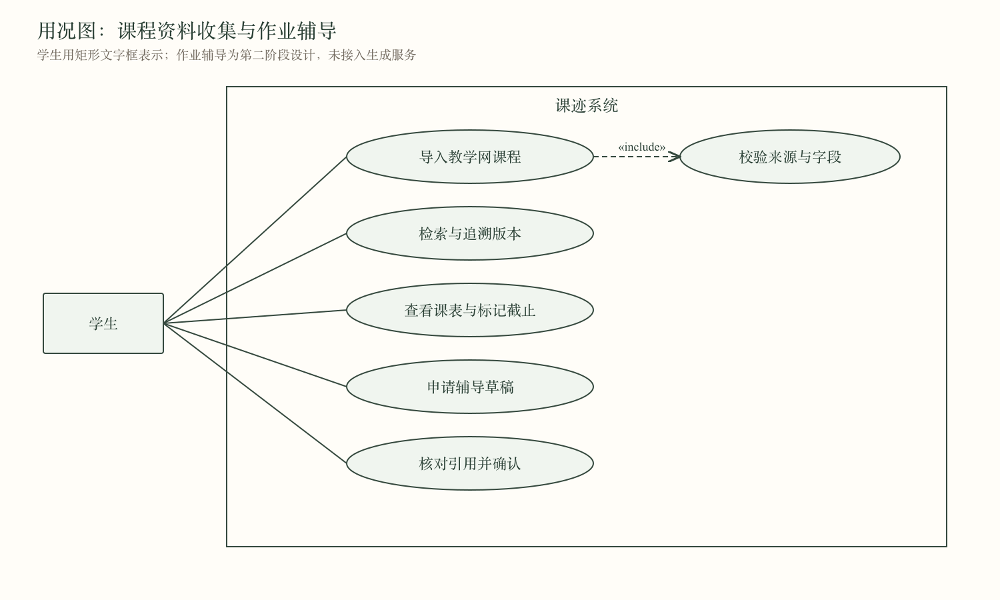
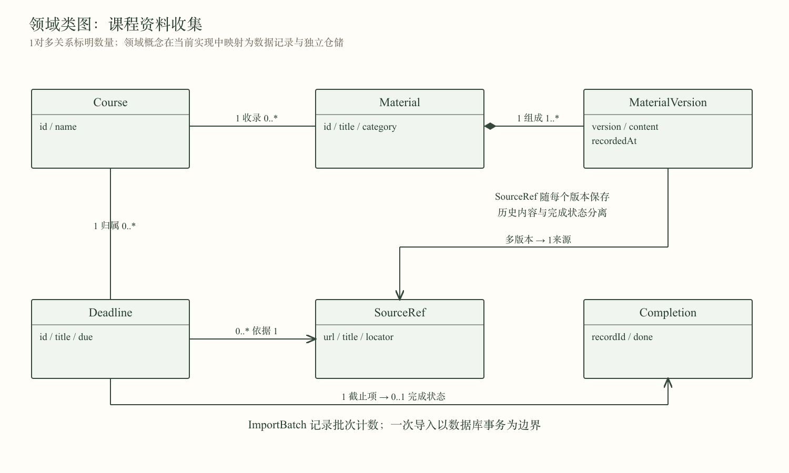
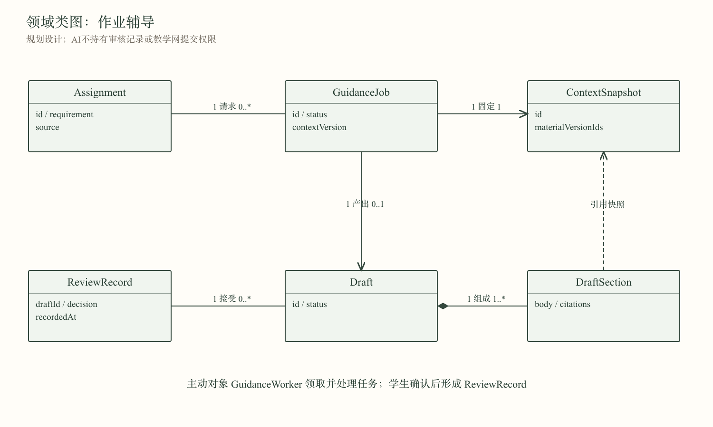
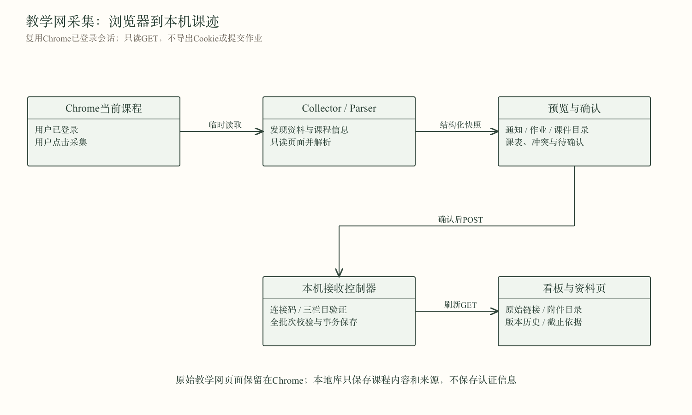
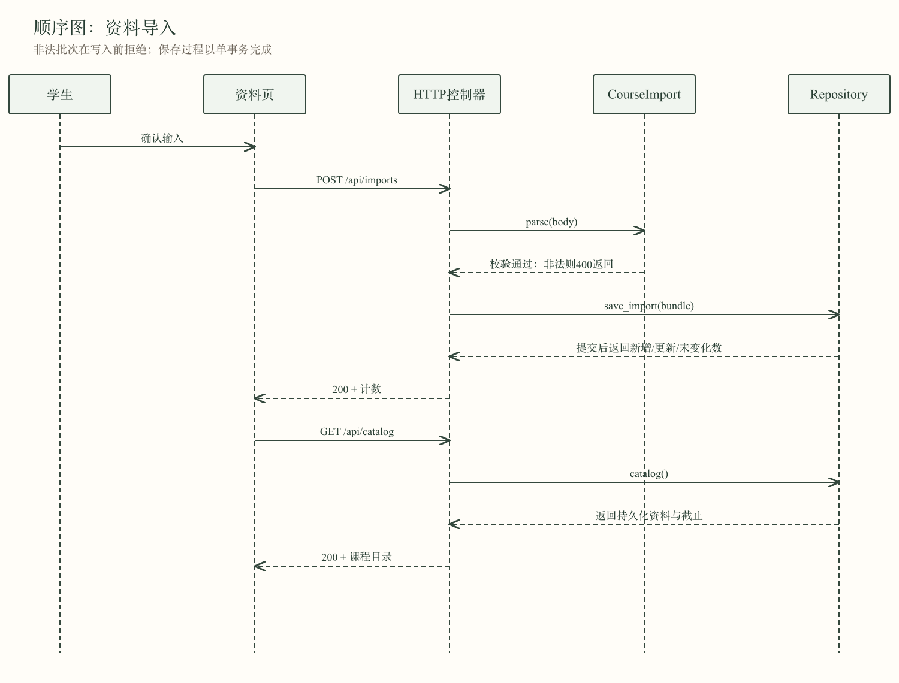
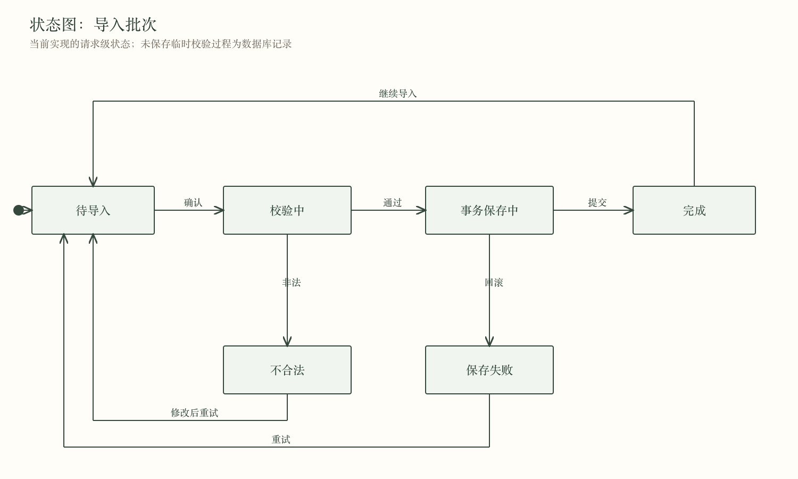
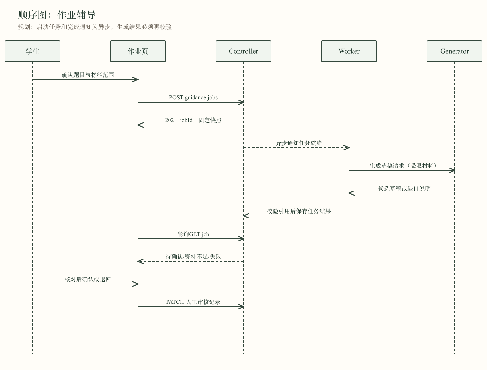
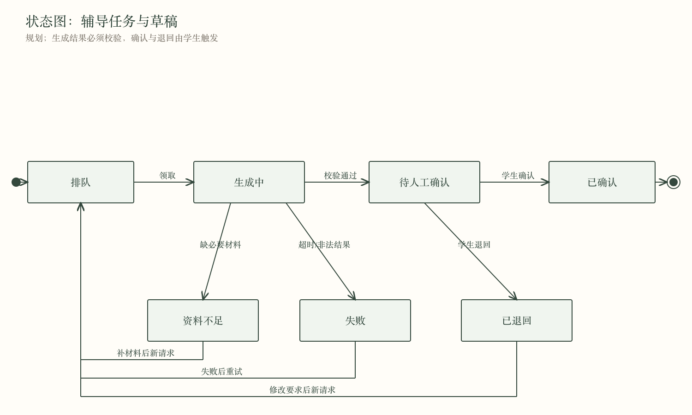
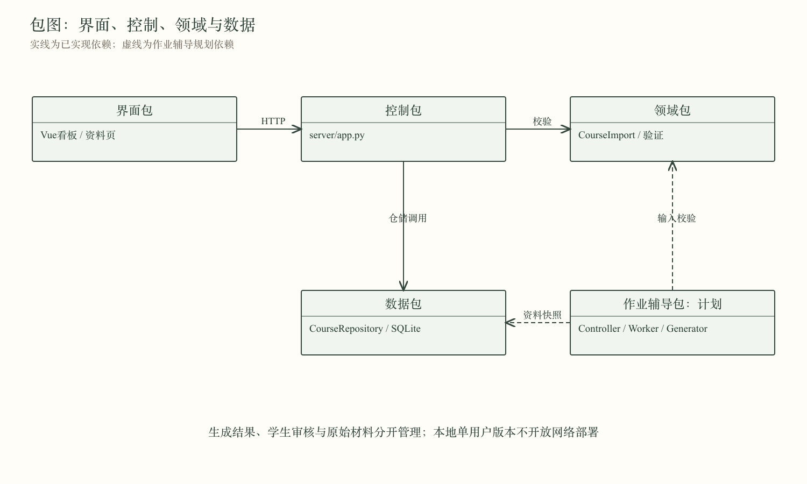
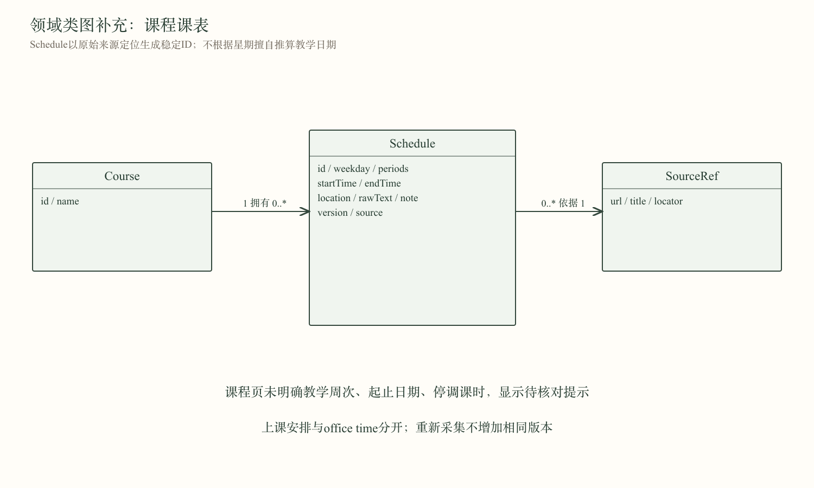

# 课迹：第二阶段面向对象分析与设计

第4组 · 戴航 · 2026年11月11日

## 1. 阶段目标与实现范围

沿用现有功能规划，分析两个核心功能：课程资料收集、作业辅导。课程看板是收集结果的展示与跟进入口。第一阶段已有五个页面的交互原型；本阶段将资料收集和看板接入本地服务与数据库，作业辅导完成领域与交互设计，页面仍为原型。

本阶段实现教学网课程导入：Chrome复用学生已登录的课程会话，发现并读取通知、作业和课件目录，预览后导入本机课迹。登录仍由学生完成；采集过程不导出Cookie、不提交教学网表单。手动文字/JSON作为补充。附件仅保存名称与链接，PDF解析、录音转写和真实模型调用不在当前实现中。具体使用与异常处理见[教学网导入](blackboard-import.md)。

课程要求依据：归档《2026秋季软件工程课程实践说明20260910.pdf》第12–13页：两个核心功能的OOA/OOD、至少一个核心功能实现展示、实际进度、Git使用、AI使用与人工评审。

## 2. 用况

参与者为学生。本机单用户版本不设置管理员角色；未来多人部署需要独立身份与课程授权。

### UC1 导入课程资料（已实现）

前置条件：本地服务可用，Chrome导入助手已由用户确认安装，教学网当前课程已登录。

1. 学生在当前课程点击导入助手；采集器从菜单发现三个栏目，仅GET读取通知、作业要求及课件目录，组装含稳定条目编号的快照。
2. 助手显示课程与各栏目数量，学生确认后使用本机临时连接码导入。手动表单/JSON仍可补充。
3. 控制器校验整个批次的字段、链接及带时区的截止日期。
4. 仓储在一个事务内保存课程、资料、截止与版本，并返回新增、更新、未变化计数。
5. 页面重新读取课程目录，资料页可检索，看板展示截止。

扩展：登录失效、缺少栏目、结构改变或任一请求失败时，采集中止，不能报告空目录。通知栏确实为空时记录0条。任一条目不合法则整批拒绝，不保存部分结果；相同课程、来源链接、来源定位的记录重复导入不新增；内容变化则增加版本，旧版仍可查。数据库写入失败时回滚。相同来源中的不同项目必须填写不同定位。更换来源链接视为新记录，当前不提供跨来源合并。

后置条件：保存结果可在刷新及服务重启后恢复，学生完成状态不被导入覆盖。

### UC2 查找资料与查看截止（已实现）

学生按课程、类型、关键词筛选资料；关键词涵盖标题、正文、来源标题和定位。选择原始来源可跳转核对；历史列表可展开旧正文。看板按时间排序截止项，支持待完成、已完成、全部筛选。勾选成功后才更新界面，失败保留原状态并显示错误。勾选是本地跟进记录，不等于向教学网提交。

### UC3 申请作业辅导（设计）

前置条件：作业要求已导入，学生确认参与生成的材料范围。

1. 学生选择作业，确认题目和可用材料。
2. 控制器创建GuidanceJob，固定ContextSnapshot并返回任务编号。
3. 主动对象GuidanceWorker异步领取任务，以受限材料调用DraftGenerator。
4. 确定性校验器检查结果结构、引用ID及版本是否属于材料快照。
5. 材料不足时返回缺口；异常或超时为失败；合法草稿进入待确认。
6. 学生核对引用并确认或退回，控制器独立记录ReviewRecord。

扩展：同一作业和快照已有活动任务时返回已有任务，避免重复启动；失败后由学生触发新请求；不得把模型输出当作用户确认。当前未实现上述服务端任务接口。

## 3. 对象与关系

### 3.1 资料收集领域

- Course收录Material并关联Deadline。
- Material由一个或多个MaterialVersion组成；版本保留正文、来源和记录时间。
- SourceRef提供链接、标题和精确定位。版本携带来源副本，避免后续来源变更影响旧引用。
- ImportBatch记录批次时间和新增/更新/未变化计数。
- Completion独立记录学生对截止项的完成状态，不属于外部资料正文。

以上是分析层领域概念。实现选择一个CourseImport数据类集中校验，用字典表示材料和值对象，以CourseRepository统一管理事务，未为每种数据记录机械增加一个Python类。

### 3.2 作业辅导领域（设计）

Assignment关联多次GuidanceJob。每个任务固定一个ContextSnapshot，最多产出一个Draft；Draft由多个DraftSection组成，每段引用所选版本。学生的每次确认或退回单独形成ReviewRecord。

GuidanceWorker为主动对象，有自己的任务执行流程。Course、Material、Deadline、Draft等为被动领域对象。当前HTTP服务器能并发处理请求，但不等于已实现辅导Worker。

## 4. 交互与状态

导入状态是一次请求内的控制状态。SQLite仅持久化成功批次；校验失败通过400返回，事务失败通过500返回，不把“失败批次审计”伪称为已实现。重新导入同一成功批次仍经过幂等判断。

辅导的任务投递为异步通知；页面轮询读取状态。模型调用结果还需经过引用校验才能成为待确认草稿。资料不足、失败均保留可理解的原因，不自动当作完成；新请求保留旧任务作为历史。

## 5. OOD

### 5.1 人机交互

保持已有课迹的侧栏与纸色界面。看板和资料页明确标识第二阶段，后三个功能标识为原型。导入表单提供字段约束，批量JSON先读入文本框、再确认；搜索无结果、API不可达、保存失败均有明确反馈。批量结果列出三类计数。来源链接用新标签打开；用户输入以Vue文本插值显示，不渲染任意HTML。

### 5.2 控制驱动

浏览器导入助手依靠activeTab临时访问当前课程，collector只执行课程范围内的GET，parser确定性解析页面，popup展示预览并在确认后传入本机。连接码只在内存中；后端校验课程、三栏目计数和来源后才进入原事务。资料页事件经useCourseStore发起API请求。HTTP Handler只处理路由、协议及错误映射；CourseImport.parse负责确定性的输入规则；CourseRepository承担事务与持久化。看板状态修改成功后才更新本地副本。

作业辅导采用Controller、ContextSelector、GuidanceWorker、DraftGenerator、ResultValidator和GuidanceRepository分工。生成器是可替换接口，确定性规则不交给模型决定。Worker只写候选结果，不写学生审核记录，不获得教学网账号与提交能力。后三类接口为计划，不伪装为已实现的生产能力。

### 5.3 数据管理

SQLite保存courses、records、history、student_state、imports。records以kind区分资料与截止；history保留每个成功版本，学生勾选独立存表。数据库使用参数化SQL；每个请求独立连接；导入在单事务中完成。

教学网快照新增course_sync记录最近核查时间、三栏目来源及计数，采集时间不混入内容版本。记录可含attachments目录和dueInfo多来源截止证据；冲突按最早候选提醒并标红，无明确时间待确认。稳定ID由记录类型、课程ID、来源URL、来源定位生成。标题和正文修改保持ID稳定。相同内容导入返回unchanged，不增版本。列表含version、updatedAt和source。截止时间必须含时区，界面统一按北京时间展示。单批JSON上限2MB，资料/截止各不超过500条。

本地服务仅监听127.0.0.1；写接口要求JSON且限制Origin与Host。数据库在.local-data中，不入Git。当前不适用于公网或多人账户；部署前需新增身份、课程授权、并发冲突控制、日志与备份管理。

## 6. 实现接口与模块

|接口|职责|状态|
|---|---|---|
|GET /api/connector|本机临时连接码|实现|
|POST /api/blackboard/imports|完整教学网课程快照导入|实现|
|GET /api/health|本地服务健康检查|实现|
|GET /api/catalog|课程、资料、截止和完成状态|实现|
|POST /api/imports|批次校验与事务导入|实现|
|GET /api/records/{id}/history|查看历史版本|实现|
|PATCH /api/deadlines/{id}|修改本地完成状态|实现|
|POST /api/guidance-jobs|创建辅导任务|设计|
|GET /api/guidance-jobs/{id}|轮询辅导状态|设计|
|PATCH /api/drafts/{id}/review|记录学生决定|设计|

|实现文件|设计职责|
|---|---|
|browser-extension/|当前课程采集、DOM解析、预览和导入|
|server/blackboard.py|课程快照来源与三栏目覆盖验证|
|server/domain.py|CourseImport、来源与时间等校验|
|server/repository.py|CourseRepository、导入事务、版本和学生状态|
|server/app.py|Handler控制器、本地服务与SPA静态文件|
|src/composables/useCourseStore.js|API调用与共享课程状态|
|src/views/MaterialsView.vue|导入、检索、版本追溯|
|src/views/DashboardView.vue|截止与课程资料概览|
|tests/test_course_store.py|持久化、事务、异常和HTTP集成测试|

## 7. 验证与限制

20项自动测试通过（11项Python测试、9项解析/采集测试），覆盖重复导入、内容更新历史、重启持久化、非法批次零写入、实际事务回滚、无效来源、完成状态约束、HTTP读写与跨来源拒绝。前端生产构建通过。

Chrome实际验收：首次导入新增2条；重复导入未变化2条；修改正文更新1条且保留版本1；不存在关键词显示0条；截止完成状态刷新后保留，验收后已恢复待完成。

当前搜索在浏览器已取得的数据上完成，适合小型课程清单；尚无分页、全文索引、多用户、定时采集与附件正文解析。AI辅导尚未接模型。图示提供Mermaid源、可编辑SVG及PNG；SVG为便于汇报阅读的手工布局版，完整条件与状态以正文及Mermaid为准。

## 8. 教学网采集与人工确认

浏览器导入前预览数量；后台只保存课程信息，不保存凭据。扩展安装、人工设计评审与组员贡献确认仍分别以用户实际操作为准。真实课程验收结果与截图在blackboard-import.md和screenshots中记录。

## 按原甘特图补齐课表

课表采集、校验、来源追溯与看板展示已实现。实际课程信息由组内保留，公开分支使用合成示例；20项测试通过。

### 课表领域补充

Schedule与资料、截止共用导入事务、稳定ID和历史版本。GET目录新增schedules数组。weekday为1–7，HH:mm起止有效且结束晚于开始；缺失或格式不明确则保留待确认，不生成假课表。实际每周时间不能替代校历中的具体教学日期。
