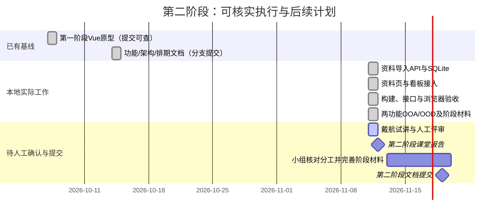

# 项目执行情况与Backlog

核查时间：2026-11-11。以远端提交、当前本地文件、构建与测试为依据；全组线下工作尚未提供，不倒填完成率或工时。

## 执行甘特图

原分支计划10月16日至11月5日做两功能分析设计，11月6日至12日实现材料拉取/GET。当前可见工作集中在11月11日补齐，已补教学网三栏目采集助手；不能将整个计划区间涂为已完成，也不据此推断组员未上传的成果。

## Backlog与本地Kanban

|ID|条目|验收条件|状态|
|---|---|---|---|
|S2-01|资料和截止导入|来源必填，非法批次不落库|完成并测试|
|S2-02|去重与版本追溯|重复不新增，变化保留旧版|完成并测试|
|S2-03|资料检索|课程/类型/关键词筛选|完成并浏览器验证|
|S2-04|看板持久化|时间排序、勾选刷新保留|完成并浏览器验证|
|S2-05|两个功能OOA/OOD|必要图示与实现对应|本地材料已备，待人工审阅|
|S2-06|课堂报告与Git展示|可复现演示、说明分支与贡献|讲稿/材料已备，待试讲|
|S2-07|组员贡献与人工评审|按真实参与情况确认|待小组提供|
|S2-08|教学网三栏目采集|已登录课程的通知/作业/课件目录，预览后导入|完成，真实课程扩展采集/导入/重复采集验收通过|
|S2-09|课表采集与看板|课程时间地点带来源、重复不新增、刷新保留|完成并真实Chrome验收|
|S2-10|技能入口与接口约定|实际接口、未来CLI任务协议及阶段边界|文档定稿|
|S3-01|更多资料适配器|更多平台与格式接入|待开发|
|S3-02|回放生成任务|转写/摘要任务可追溯|待开发|
|S3-03|作业辅导服务|材料快照、受限生成、引用校验、人工确认|待开发|

完成列：S2-01–04、S2-08–10。待审列：S2-05–06。待组内确认列：S2-07。后续待办：S3-01–03。此表是本地Kanban记录，不声称已配置GitHub Projects。

本次开发由戴航发起、AI辅助实现；其他7名组员的具体姓名和贡献未提供，保留待确认。

估算使用相对工作量（后续计划，不是实际工时）：S2-08高优先级/3点；S3-01中优先级/3点；S3-02高优先级/5点；S3-03高优先级/5点。点数待小组评审。

## 2026-11-11 真实课程验证

通过Chrome已登录会话读取测试课程三栏目及作业说明页的指定DOM区域，经扩展共用解析器生成课程清单，再用资料页JSON入口入库。结果为2条通知、7项作业、7项课件目录及7个截止项，共23条记录。首次新增23条，重复导入新增0、更新0、未变化23条。课件类型筛选显示7项，原始链接和附件链接可见。某测试作业同时保留列表两处不同日期的冲突依据。

## 原计划对齐结果

新增课表与入口/接口约定已补齐，完整原条目对照见stage2-acceptance.md。自动测试现20项，真实课表已导入，重复24条未变化。原计划日期不修改，实际开发集中于11月11日。
